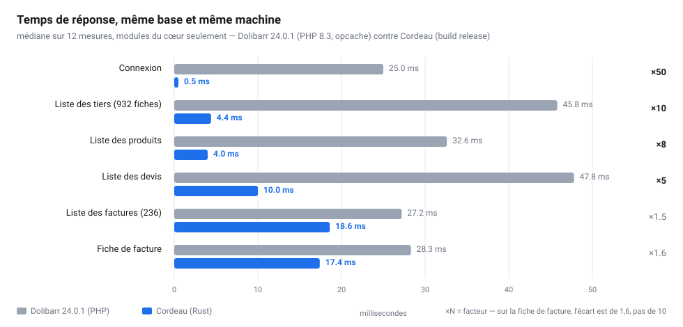

# Annonce forum — un noyau Dolibarr écrit en Rust (projet de test, offert)

> Section suggérée : **forum.dolibarr.org → Développement**.
> Le texte est prêt à copier. Les images sont dans `docs/captures/` : GitHub ne
> les affiche pas depuis un autre site, il faut les joindre au message.

---

**Sujet : j'ai réécrit le noyau Dolibarr en Rust pour comprendre Dolibarr — je le donne à qui veut**

Bonjour,

Je suis architecte et maçon, pas développeur. Je lis ce forum depuis un moment,
et comme beaucoup ici je butais sur deux choses : la lenteur de certains écrans
sur une base qui grossit, et les zones grises du schéma quand on veut brancher
quelque chose à côté.

Alors j'ai fait ce petit projet : **un noyau Dolibarr réécrit en Rust, qui lit la
même base**. Pas un fork, pas un remplacement — le même schéma, à l'octet près.
Dolibarr PHP relit la base sans rien voir, et on revient en arrière quand on
veut.

C'est un **projet de test**. Il pourrait devenir une « version 30 », ou rester
une curiosité ; ce n'est pas mon métier, et **je le donne volontiers à qui veut
le reprendre** — la licence est GPL-3.0, comme Dolibarr, puisque c'est une œuvre
dérivée. Ce qui m'intéresse, c'est que ça serve : à Dolibarr, à un développeur
qui cherche une base pour expérimenter, ou à un artisan qui veut des écrans qui
répondent.

**Ce qui est déjà fait et testé**

Pas mal, en fait : **1 057 tests**, `clippy` propre, et un script de vérification
en huit étages (formatage, analyse statique, tests, **empreinte du schéma**
Dolibarr, chaînes de migration 12/19/23 → 24, chaîne métier complète
devis → facture → règlement → PDF, dix écrans, annuaire).

- base **Dolibarr 24.0.1 utilisée telle quelle** : 487 tables lues, 410 tables du
  cœur intactes ;
- **298 routes, 66 écrans** — devis, commandes, factures, avoirs, règlements,
  situations, achats, chantiers, banques, comptabilité, tickets, documents,
  agenda, portail client ;
- les **mêmes menus, les mêmes onglets** : quelqu'un qui connaît Dolibarr ne
  réapprend rien ;
- PDF conformes au droit français (mentions, CGV, RIB, TVA sur encaissements) ;
- **Factur-X** : le XML EN 16931 attaché au PDF, vérifié en relisant le fichier ;
- fichiers **SEPA** `pain.001` et `pain.008`, IBAN contrôlés modulo 97 ;
- **API compatible** `/api/index.php` et un serveur **MCP** (26 outils).

**Ce que ça donne, mesuré**

Même machine, même base (copie de production : 932 tiers, 236 factures), modules
du cœur seulement, build `release`, PHP 8.3 avec opcache :

| Page | Dolibarr 24 | Cordeau |
|---|---|---|
| Connexion | 25 ms | 0,5 ms |
| Liste des tiers (932) | 46 ms | 4,4 ms |
| Liste des produits | 33 ms | 4,0 ms |
| Liste des devis | 48 ms | 10 ms |
| Fiche de facture | 28 ms | 17 ms |

Et tout de suite la limite, parce qu'elle compte : `php -S` sert une requête à la
fois, donc ces chiffres disent la **latence**, pas le débit à vingt utilisateurs.
Sur une fiche de facture — là où il y a du vrai travail par ligne — l'écart est
de **1,6 ×**, pas de 10 ×. Le protocole complet est dans
`docs/COMPARAISON-MESUREE.md`.

**Ce que réécrire m'a appris sur Dolibarr — et qui peut servir**

C'est la partie qui vous intéressera peut-être le plus. Une deuxième
implémentation bute sur tout ce que la première faisait sans le dire. J'ai noté
les cinq endroits qui m'ont coûté du temps :

1. **un statut `2` veut dire trois choses** : payée (facture), signée (devis),
   livrée (commande) ;
2. **un acompte est lié au devis mais ne le facture pas** : un contrôle naïf
   empêche la facture finale de sortir, et le client paie deux fois ;
3. **le numéro légal** : un brouillon qui consomme un numéro laisse un trou
   définitif dans la suite ;
4. **le dictionnaire des unités** peut être vidé, et Dolibarr imprime alors
   `ErrorBadValueForParamNotAString` dans la colonne Unité du PDF ;
5. **le code d'exonération de TVA** (`einvoice_vatex`, colonne ajoutée en 23.0)
   n'est rempli par défaut sur aucune base réelle : une ligne à 0 % part sans
   motif, et la plateforme agréée la refuse.

Le détail, avec la reproduction de chacun, est dans
`docs/CE-QUE-REECRIRE-APPREND.md`. Ce ne sont pas des reproches : ce sont des
interprétations possibles, et si ça peut aider un mainteneur à trancher, tant
mieux.

**Ce qui ne marche pas encore**

- réception de factures électroniques : le code existe, il faut une plateforme
  agréée (partenariat) ;
- connecteurs Stripe, PayPal, LDAP, OAuth : non livrés ;
- installateur **Windows** seulement ;
- aucun test de charge : je n'ai pas mesuré vingt utilisateurs simultanés ;
- 66 écrans, pas les 400 de Dolibarr : la GRH avancée, le MRP fin, le
  multi-entrepôts complexe ne sont pas tous là.

**Ce que je cherche**

Des testeurs avec une **vraie base**, qui veulent essayer en lecture sur une
copie, et me dire ce qui diffère : un écran faux, un PDF différent, une base
exotique qui coince. Et si quelqu'un veut reprendre le projet, il est à lui.

Dépôt : <https://github.com/clicqueur2/cordeau> (le README dit ce que ça fait,
`INSTALLER.md` comment l'installer).

Merci d'avoir lu.
